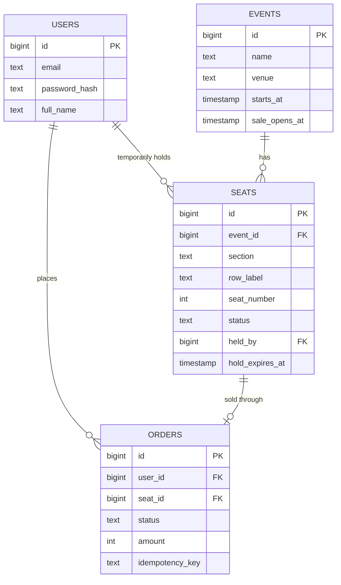
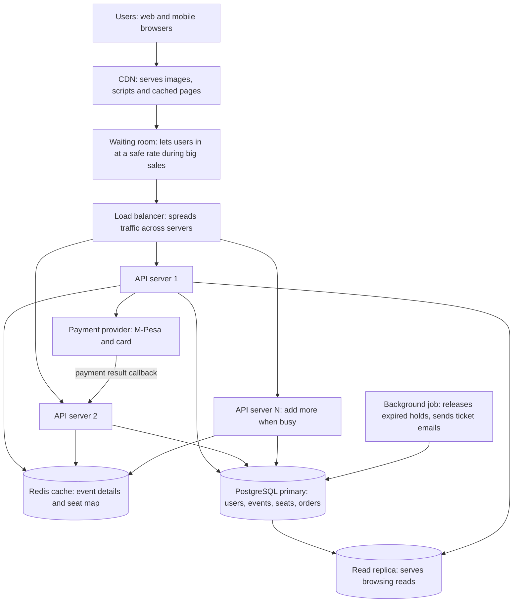

# TicketHub: Event Ticketing System Design

TicketHub is a website that sells tickets for concerts and events. This document follows the six-part design framework: requirements, estimates, API, data model, architecture, and trade-offs. It also explains how the design stops two people from buying the same seat.

---

## 1. Requirements

### Functional requirements

- Users can register, log in, and view their account.
- Users can browse and search upcoming events.
- Users can view an event's seat map and see which seats are available.
- Users can hold a seat for a short time while they pay.
- Users can pay for held seats and receive a ticket.
- Users can view their purchased tickets.
- A seat can only ever be sold to one person.

### Non-functional requirements

- **Speed:** browsing pages load in under 1 second; seat map loads in under 2 seconds, even during a big sale.
- **Correctness:** a seat is never sold twice, and a customer is never charged without getting a ticket.
- **Fairness:** during a big sale, people are served roughly in the order they arrived. Bots and refresh-spamming should not beat real users.
- **Availability:** the site stays up during a big sale. If it is overloaded, it should slow down gracefully (a queue) rather than crash.
- **Durability:** once an order is paid, it is never lost.

---

## 2. Estimates

Given facts: 2 million registered users; 50,000 visitors on a normal day, each viewing 10 pages; 5,000 tickets sold on a normal day; on a big sale, 200,000 people try to buy 20,000 seats within the first 10 minutes.

### Normal day

| Measure | Calculation | Result |
|---|---|---|
| Page views per day | 50,000 x 10 | 500,000 |
| Average page requests per second | 500,000 / 86,400 | about 6 per second |
| Busy-hour peak (assume 10x average) | 6 x 10 | about 60 per second |
| Tickets sold per second (average) | 5,000 / 86,400 | about 0.06 per second |
| Tickets sold per second (peak, 10x) | 0.06 x 10 | about 0.6 per second |

### Big-sale peak

| Measure | Calculation | Result |
|---|---|---|
| Users arriving per second | 200,000 / 600 seconds | about 333 per second |
| Page requests per second | 200,000 x 10 pages / 600 | about 3,300 per second |
| Seats to sell per second (if they sell out) | 20,000 / 600 | about 33 per second |
| Competition for each seat | 200,000 / 20,000 | 10 people per seat |

### Comparison

- Page requests: about 3,300 per second versus about 6 on an average day, which is roughly **550 times** more. Even against the normal busy-hour peak (60 per second) it is about 55 times more.
- Purchases: about 33 per second versus about 0.06, which is more than **500 times** more.
- Almost everything happens at the same moment on the same 20,000 rows. So the main danger is not total data size; it is **many people fighting over the same seats at once**. The design must protect correctness (no double-booking) and shed load (queue and cache) at the same time.

---

## 3. API Design

All endpoints use JSON over HTTPS. Endpoints that change data need a logged-in user (token in the `Authorization` header).

| # | Method and path | Purpose | Notes |
|---|---|---|---|
| 1 | `GET /events?page=1&q=concert` | Browse and search events | Public, cached |
| 2 | `GET /events/{event_id}` | View one event's details | Public, cached |
| 3 | `GET /events/{event_id}/seats` | View seats and their status (available, held, sold) | Cached for 1-2 seconds during a big sale |
| 4 | `POST /events/{event_id}/seats/{seat_id}/hold` | Hold a seat for 8 minutes | Returns `201` with `hold_expires_at`, or `409 Conflict` if taken |
| 5 | `DELETE /events/{event_id}/seats/{seat_id}/hold` | Release a hold early | Only the holder can do this |
| 6 | `POST /orders` | Pay for the held seat(s) | Needs an `Idempotency-Key` header so a double tap does not charge twice |
| 7 | `POST /payments/mpesa/callback` | Payment provider tells us the payment result | Called by the provider, verified by signature |
| 8 | `GET /users/me/tickets` | View my purchased tickets | Logged in only |

### Example: hold a seat

Request:

```http
POST /events/42/seats/9001/hold
Authorization: Bearer <token>
```

Success response (`201 Created`):

```json
{
  "seat_id": 9001,
  "status": "held",
  "hold_expires_at": "2026-11-05T18:08:00Z"
}
```

Failure response (`409 Conflict`):

```json
{ "error": "SEAT_UNAVAILABLE", "message": "This seat has just been taken." }
```

### Example: pay for an order

Request:

```http
POST /orders
Authorization: Bearer <token>
Idempotency-Key: 7c1f0a52-3d6e-4e8a-9a55-0d6c1b9e2a10

{ "seat_ids": [9001], "payment_method": "mpesa", "phone": "2547XXXXXXXX" }
```

Response (`202 Accepted`): the order is created as `pending` and the user is asked to approve the payment on their phone. The final result arrives through endpoint 7.

---

## 4. Data Model

### Tables

**users**

| Column | Type | Notes |
|---|---|---|
| id | BIGINT | Primary key |
| email | TEXT | Unique, not null |
| password_hash | TEXT | Never store plain passwords |
| full_name | TEXT | |
| created_at | TIMESTAMP | |

**events**

| Column | Type | Notes |
|---|---|---|
| id | BIGINT | Primary key |
| name | TEXT | Not null |
| venue | TEXT | |
| starts_at | TIMESTAMP | Indexed for browsing by date |
| sale_opens_at | TIMESTAMP | When tickets go on sale |
| total_seats | INT | |

**seats**

| Column | Type | Notes |
|---|---|---|
| id | BIGINT | Primary key |
| event_id | BIGINT | Foreign key to events.id |
| section | TEXT | |
| row_label | TEXT | |
| seat_number | INT | |
| price | INT | Stored in the smallest currency unit, to avoid decimal errors |
| status | TEXT | `available`, `held` or `sold` |
| held_by | BIGINT | Foreign key to users.id, null unless held |
| hold_expires_at | TIMESTAMP | Null unless held |

Constraint: `UNIQUE (event_id, section, row_label, seat_number)` so the same physical seat cannot be created twice for one event.

**orders**

| Column | Type | Notes |
|---|---|---|
| id | BIGINT | Primary key |
| user_id | BIGINT | Foreign key to users.id |
| seat_id | BIGINT | Foreign key to seats.id |
| status | TEXT | `pending`, `paid`, `failed` or `cancelled` |
| amount | INT | Price paid |
| payment_reference | TEXT | From the payment provider |
| idempotency_key | TEXT | Unique, stops duplicate orders from double taps |
| created_at | TIMESTAMP | |

Each order row is for one seat. Buying several seats at once creates several order rows in one transaction.

Constraint: a **partial unique index** on `orders (seat_id) WHERE status IN ('pending', 'paid')`. This means the database itself refuses a second active order for the same seat.

### Relationships



In words:

- One event has many seats (one-to-many).
- One user can place many orders (one-to-many).
- One seat can have at most one active order (one-to-one at a time, enforced by the partial unique index).
- A user can temporarily hold many seats through `seats.held_by`.

---

## 5. How Double-Booking Is Prevented

Two people clicking the same seat at the same millisecond is the central problem. The design uses three layers, so even if one fails, the others protect the seat.

### Layer 1: One atomic conditional update

Holding a seat is a single SQL statement, not "read, then decide, then write":

```sql
UPDATE seats
SET status = 'held',
    held_by = :user_id,
    hold_expires_at = now() + interval '8 minutes'
WHERE id = :seat_id
  AND (status = 'available'
       OR (status = 'held' AND hold_expires_at < now()));
```

The database locks that seat's row while the update runs. If two people send this at the same moment, the database processes them one after the other. The first one changes the row and the statement reports **1 row updated**. The second one finds the status is no longer `available`, so it updates **0 rows**. The API sees 0 rows and returns `409 Conflict`. Only one person can ever win.

The wrong way would be to first `SELECT` the seat, check in code that it is free, and then `UPDATE`. In the gap between those two steps, a second user could also see it as free, and both would believe they got it. A single conditional `UPDATE` removes that gap.

### Layer 2: A transaction around payment confirmation

When the payment succeeds, one transaction does all of this together:

1. Lock the seat row (`SELECT ... FOR UPDATE`).
2. Check the seat is still held by this user and the hold has not expired.
3. Set the seat to `sold`.
4. Mark the order `paid`.
5. Commit.

A transaction is all-or-nothing. If any step fails, everything is rolled back, so we never end up with a seat marked sold but no paid order, or a paid order for a seat someone else owns.

### Layer 3: Database constraints as the last line of defence

- The partial unique index on `orders (seat_id)` for active orders means that even if there were a bug in the application code, the database would reject a second active order for the same seat.
- The unique `idempotency_key` means a double tap or a retry cannot create two orders or two charges.

### Expiring holds

A hold lasts 8 minutes. If the user does not pay, the hold is treated as expired. The update in Layer 1 already allows a new user to take a seat whose hold has expired, and a small background job also resets expired holds to `available` every minute so the seat map stays accurate.

---

## 6. Architecture



### What each component does

| Component | Role | Why it is needed |
|---|---|---|
| **CDN** | Serves static files (images, scripts) and cached event pages from locations close to the user | Takes most of the browsing load off our servers, which keeps pages fast |
| **Waiting room (queue)** | During a big sale, puts users in a line and lets them in at a rate the system can handle | Stops 200,000 people hitting the seat-buying code at once; also makes it fair, because people are admitted in the order they arrived |
| **Load balancer** | Spreads requests across several API servers and removes any server that fails | No single server is a bottleneck or single point of failure |
| **API servers** | Run the business logic: holds, orders, tickets. They keep no state themselves, so we can add more servers when traffic grows | Easy horizontal scaling |
| **Redis cache** | Stores event details and a short-lived copy of the seat map | Thousands of people looking at the seat map do not each hit the database. A 1-2 second old map is fine for display, because the real check happens at hold time |
| **PostgreSQL primary** | The single source of truth for seats and orders; handles the locks, transactions and constraints | Gives the correctness guarantees needed to prevent double-booking |
| **Read replica** | A copy of the database used for read-only queries such as browsing and search | Keeps heavy reads away from the primary, which is busy with writes |
| **Payment provider** | Handles M-Pesa and card payments and tells us the result by callback | We never store card details ourselves |
| **Background job** | Releases expired holds, retries failed callbacks, sends ticket confirmations | Keeps the slow work out of the user's request |

### How it survives the big sale

1. **Before the sale:** event pages and images are already cached on the CDN and in Redis, so the browsing traffic barely touches the database.
2. **At the start:** 200,000 users arrive, but the waiting room admits them gradually (for example a few hundred per second). The API servers never see the full spike.
3. **Seat map:** served from Redis and refreshed every 1-2 seconds, so thousands of viewers cost almost nothing.
4. **Buying:** only admitted users reach the hold endpoint. The roughly 33 holds per second that matter are easily handled by one PostgreSQL primary, because each hold is a tiny single-row update.
5. **Contention:** the database row lock decides every race, so no matter how many people click the same seat, only one gets it.
6. **Overload:** if servers get busy, the load balancer and extra API servers absorb it, and the waiting room slows new entries instead of letting the system crash.
7. **After the sale:** sold-out status is cached, so people arriving late see "Sold out" quickly without touching the database.

---

## 7. Trade-offs

### Trade-off 1: Strong consistency in the database versus speed from a cache

- **Choice:** the seat map shown to users may be 1-2 seconds old (cached), but the hold and payment steps always go to the PostgreSQL primary.
- **Benefit:** the site stays fast, and the database is not flooded by people only looking at seats.
- **Cost:** a user may click a seat that the cached map still shows as available but that was just taken. They get a clear "just taken" message and pick another seat.
- **Why acceptable:** a slightly stale display is a small annoyance, but a double-booked seat is a serious failure, so correctness is placed where it matters most.

### Trade-off 2: Waiting room fairness versus convenience

- **Choice:** during big sales, everyone waits in a queue instead of racing directly for seats.
- **Benefit:** the system stays up, and the order of arrival is respected, which is fair and discourages bots.
- **Cost:** users must wait and cannot instantly pick a seat; some may give up. This adds an extra component to build and operate.
- **Why acceptable:** a slow but working sale is better than a fast crash where nobody can buy.

### Trade-off 3: Length of the seat hold

- **Choice:** an 8-minute hold.
- **Benefit:** users have enough time to complete an M-Pesa or card payment.
- **Cost:** if people hold seats and walk away, those seats are unavailable to others for up to 8 minutes, which hurts sales during a sell-out.
- **Why acceptable:** a shorter hold would cause failed payments and frustration; 8 minutes balances both. It can be tuned for big sales (for example 5 minutes).

### Trade-off 4: One relational database versus splitting the data

- **Choice:** keep users, events, seats and orders together in one PostgreSQL database.
- **Benefit:** real transactions and constraints across seats and orders, which is exactly what double-booking prevention needs. It is also simpler to build and reason about.
- **Cost:** the primary database is a single write point, so it cannot scale writes forever.
- **Why acceptable:** the estimates show only about 33 writes per second at the peak, well within what one primary can do. If the business grew far larger, events could be split across databases (sharding by event).
-